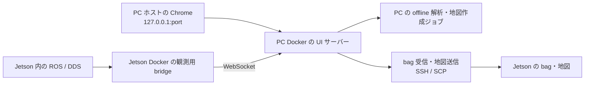

# kart の Docker 構成を参考にした ATD 環境セットアップ案

調査日: 2026-11-16

この文書は環境構築の比較・方針と、初期実装の状況をまとめる。
共通依存・DDS の起動処理は実装したが、対象 PC / Jetson への導入・Docker build・実通信検証は未実施である。TUI / UI 本体は後工程とする。
確定要件は [project_requirements.md](project_requirements.md)、既存の CLI・Docker 実装は [isaac_ros_build_strategy.md](isaac_ros_build_strategy.md) を参照する。

## 1. 推奨する構成

既存の `isaac_ros → realsense455 → atd` を基盤に、共通の開発・記録・デバイスアクセス・対話操作の環境を整える。
PC 専用の追加解析依存は amd64 側だけに導入し、Jetson に学習・地図編集用の環境を一括導入しない。
共通 Web アプリでは NVIDIA 公式 offline 処理による cuVSLAM / VGL 地図の準備を扱う方針となった。個別の入力・モデル・地図形式や自動運転アルゴリズムの具体化は、今回の基盤整備から切り離す。
イベントカメラは今後使用せず、関連 SDK・driver・ROS package・Python 依存を現在・将来とも導入対象から除外する。

| 層・役割 | PC / amd64 | Jetson / arm64 |
| --- | --- | --- |
| ホスト | Ubuntu 24.04、NVIDIA driver、Docker / Container Toolkit、apt 版 Isaac ROS CLI、Chrome、SSH / rsync、起動用 fzf | JetPack 7.2、Docker / Container Toolkit、apt 版 CLI、BlueZ、USB / 入力デバイス権限、SSH / rsync、起動用 fzf |
| `isaac_ros` | NVIDIA の対応ベース、Lyrical、CUDA 等 | 対応する Jetson ベース、Lyrical、CUDA 等 |
| `realsense455` | 既存の SDK / ROS driver 構成を維持 | 同左。実 D455 の取得を担当 |
| `atd` の共通依存 | C++ / ament / component、bag / MCAP、fzf、開発・診断ツール、bridge | 同左。ブラウザ自体は動かさない |
| PC 専用の追加依存 | 必要になった解析ライブラリと UI の依存を追加 | 導入対象から除外 |
| 自作ワークスペース | PC 上で `atd_*` をビルドし、offline 処理を実行 | Jetson 上で `atd_*` をビルドし、取得・走行処理を実行 |

初期は Dockerfile を増やし過ぎず、PC 専用依存が必要になった時点で `Dockerfile.atd` 内の対象アーキテクチャ分岐として追加する案を推奨する。
この分岐は Docker 内の `dpkg --print-architecture` を使い、実行ホストの CPU 名だけで導入内容を決めない。
ホストごとに一つの開発コンテナを使う現在の構成を維持し、記録 / 解析の起動モード切替を再導入しない。

NVIDIA は apt 版 CLI、workspace YAML、`Dockerfile.<image_key>` による拡張を提供しており、この構成のために CLI 本体を fork する必要はない。[公式拡張方法](https://nvidia-isaac-ros.github.io/v/release-5.0/concepts/dev_env/index.html#custom-docker-image-layers)

## 2. 調査対象と確認範囲

参照先: [Arata-Stu/kart の docker](https://github.com/Arata-Stu/kart/tree/main/docker)

- GitHub API で確認した `main`: `e5224221733dd4271d7132d8febcb80e91916063`。
- 対応するローカル checkout `/Users/at/project/competition/kart` は同じ commit で、読み取り時に未コミット変更はなかった。
- Dockerfile、起動引数、device group hook、Python 依存、関連する起動スクリプト・UI 資料を読み取った。
- GitHub とローカルの同一性確認、ソース調査、ATD の現構成との比較までを実施した。対象 Ubuntu ホストへの導入、Docker build、GPU・USB・Bluetooth・ROS 実行は今回行っていない。

以下の参照リンクは、調査時の内容を追えるよう commit に固定する。

## 3. kart から参考にする設計

| 参照元 | 確認した構成 | ATD への取り込み案 |
| --- | --- | --- |
| [Dockerfile.realsense](https://github.com/Arata-Stu/kart/blob/e5224221733dd4271d7132d8febcb80e91916063/docker/Dockerfile.realsense) | SDK 2.56.3 / driver 4.56.3、RSUSB、SDK の CUDA 無効化、Lyrical パッチ | ATD の既存 `realsense455` 方針と一致。SDK のみ CUDA 無効を維持する |
| [Dockerfile.kart](https://github.com/Arata-Stu/kart/blob/e5224221733dd4271d7132d8febcb80e91916063/docker/Dockerfile.kart) | 重い SDK 層の後で依存を追加。日常ツールを後段に置き、BuildKit cache を利用 | 共通の開発・記録ツールを追加する際の構成を参考にする |
| [docker/python](https://github.com/Arata-Stu/kart/tree/e5224221733dd4271d7132d8febcb80e91916063/docker/python) | 用途別 venv と pyproject / uv.lock、amd64 専用依存の分岐 | uv を共通基盤として ROS 2 用・AI 学習用の環境を分離し、依存の版は ATD 向けに選定する |
| [kart-device-groups.sh](https://github.com/Arata-Stu/kart/blob/e5224221733dd4271d7132d8febcb80e91916063/docker/scripts/kart-device-groups.sh) | root entrypoint で追加 GID を登録し、その後の非 root 実行でも利用 | 実デバイスを一般ユーザーから利用する仕組みを参考にする。GPU ノードの権限修正は実機診断後に判断する |
| [dockerargs](https://github.com/Arata-Stu/kart/blob/e5224221733dd4271d7132d8febcb80e91916063/docker/dockerargs) | DDS 設定を全プロセスへ渡す。コンテナからの Bluetooth 管理用にホスト D-Bus を共有 | DDS 設定を起動経路間で統一する設計を参考にする。DDS の種類や D-Bus 共有は別途判断する |
| [kart-ros.bash](https://github.com/Arata-Stu/kart/blob/e5224221733dd4271d7132d8febcb80e91916063/docker/scripts/kart-ros.bash) | ROS 環境の読込みと短い `webui` 入口 | ATD の標準 workspace パスへ合わせて、短い UI 起動入口を設ける |
| [UI の起動・構成](https://github.com/Arata-Stu/kart/blob/e5224221733dd4271d7132d8febcb80e91916063/tools/app/README.md#起動) | PC の Docker 内に localhost サーバーを置き、ブラウザで操作。重い ROS 処理は別プロセス | 地図・転送・ライブ表示の流れを基本とし、Joy UI も統合する。framework や旧 kart の走行操作は別に判断する |

### 対象外と後工程の依存

イベントカメラ関連の依存は完全に対象外とする。依存一覧への関連名の追加も起動スクリプトで拒否する。
YOLO / ByteTrack、学習、raceline、MuJoCo、個別の SLAM・地図生成手法は、現在の基盤セットアップには含めない。
このうち cuVSLAM / VGL の地図準備とライン生成は、今後の共通アプリの機能要件に含む。基盤セットアップへの依存導入が完了したことは意味しない。
同様に、kart 固有の PyTorch / torchvision、NumPy / Shapely の補正、jetson-stats の pin / patch は一括移植しない。
必要になった機能ごとに依存と互換性を検討する。

kart の `/workspaces/ros2_ws` 固定パスや独自 CLI の mount 規則も移植せず、ATD の標準 workspace `/workspaces/isaac_ros-dev` を維持する。
既存 ATD の `/workspaces/atd` 参照用 mount と `/data/record`、`/data/results` の常時 rw mount は維持する。

## 4. 共通依存と起動処理の実装

共通の apt 依存は [dependencies.apt](../docker/dependencies.apt) で管理する。
`install-dependencies.sh` が root / Lyrical と依存一覧を検査し、`dpkg-query` で不足したものだけ導入する。すべて導入済みなら apt 操作を行わず、毎回の apt upgrade も行わない。
対象ホストでの apt 配布・版の整合と実際のインストール成功は、Docker build と実起動で確認する。

| 用途 | 依存の例・方針 |
| --- | --- |
| C++ / component 開発 | build-essential、CMake、Ninja、pkg-config、ament_cmake_auto、ament_cmake_python、rclcpp_components、colcon / rosdep |
| ROS 基本データ | sensor_msgs、geometry_msgs、nav_msgs、tf2、launch 等。自作 package.xml に応じて追加 |
| 記録・再生 | ros2bag / rosbag2、MCAP storage plugin、必要に応じ rosbag2_py。カメラ取得と記録の確認を先に行う |
| Joy | ROS joy とその入力依存。独自 firmware や操舵アプリを決めなくても、DualSense の入力まで確認できる |
| 対話操作・作業補助 | fzf、tmux、bash-completion、ripgrep、jq、less |
| 転送・診断 | rsync、openssh-client、usbutils、v4l-utils、iproute2、tcpdump、htop 等 |
| 通信・観測 | Fast DDS の RMW と loopback UDP の XML、Foxglove Bridge。bridge の公開設定・起動は後工程 |

`fzf` はコンテナ内だけでなく、ホストの起動メニューでも使えるようにする。
変更頻度の低い RealSense の build を前に置き、日常ツールや軽いプロジェクト依存は後ろに置く。
依存一覧と導入スクリプトを Dockerfile でも実行し、既知の依存をイメージにキャッシュする。新規コンテナ起動時にも同じスクリプトを必ず実行し、不足分を確認する。
上流 CLI の `--rm` によりコンテナが再作成される場合でも、既知の依存の毎回の再導入を減らす。

起動時の処理は `10-atd-runtime.sh → install-dependencies.sh → configure-dds.sh → gosu admin 経由の atd-python ros sync` とする。
DDS の生成先は `/etc/atd/fastdds.xml` と `/etc/atd/dds.env.sh` であり、依存と設定の準備成功後に `runtime.ready` を記録する。
`atd-shell` はこれらの環境を利用し、ホストの旧 `.bashrc` を読み込まない。Docker ENV と `BASH_ENV` も設定する。

`scripts/dev.sh` は稼働中コンテナの mount、runtime API、環境・構成識別子、準備完了記録を確認してから `atd-shell` へ再接続する。
再接続時には依存や DDS を更新せず、構成が変わった場合や旧コンテナは再作成を求める。

### Python の扱い

- Docker 内の Python 環境構築には uv を使い、ROS 2 用と AI 学習用を独立した project / lock / venv で管理する。
- ROS 2 用はベースのシステム Python と ROS の apt パッケージに合わせ、`--system-site-packages` を使う。完全隔離ではないことを踏まえ、追加依存と ROS 2 の import・版の互換性を確認する。
- 学習用は system site-packages と ROS 2 の `PYTHONPATH` を引き継がない。解析・推論等の環境がさらに必要になったら、用途と互換性に応じて分ける。
- kart の pin をそのまま流用せず、ATD が使用するライブラリと対象アーキテクチャを根拠に固定する。
- GPU モデルを採用する場合も、モデル取得や TensorRT engine 生成を日常ツールの build へ混在させない。engine の対象 GPU との互換性は別途確認する。

具体的な操作と制約は [Python 環境](python_environments.md)を参照する。学習 framework と CUDA wheel は未選定である。

## 5. ホストとデバイスの準備

### PC

Ubuntu 24.04、対応する NVIDIA driver、Docker Engine、NVIDIA Container Toolkit、apt 版 Isaac ROS CLI、Chrome、SSH / rsync、fzf を準備する。
ホストに ROS / librealsense を重複導入することは標準手順に含めない。
公式の x86 対応表は Ampere 以降・GPU メモリ 8GB 以上、CUDA 13.2 以上、Driver 595 以上を記載している。実際の RTX 4060 の VRAM と driver を診断で確認する。[公式対応環境](https://nvidia-isaac-ros.github.io/v/release-5.0/getting_started/index.html#supported-platforms)

### Jetson

JetPack / BSP と SSD、Docker / Container Toolkit、apt 版 CLI、BlueZ、SSH / rsync、fzf、USB / HID / 将来のシリアルデバイスのアクセス権を準備する。
Chrome の起動や PC 用の重い解析・学習環境を標準起動へ含めない。
既存の OS や driver を一律に再インストールする手順にはせず、導入済みの版と状態を確認して不足を補う。

### D455 と DualSense

- D455 のホスト側 udev、USB 3 接続、Docker 内の SDK / driver、一般ユーザーからのアクセスをそれぞれ確認する。[公式 RealSense 手順](https://nvidia-isaac-ros.github.io/v/release-5.0/getting_started/sensors/realsense_setup.html)
- DualSense のペアリングと `bluetoothd` は Jetson ホスト側、ROS の入力取得は車載コンテナ側を基本案とする。
- `joy` の入力は `/dev/input/event*` も対象になる。`/dev/input/js0` だけを渡すことを前提にしない。[公式 joy 資料](https://github.com/ros-drivers/joystick_drivers/blob/ros2/joy/README.md)
- input / video / dialout 等は必要な実デバイスの数値 GID を確認し、非 root のコンテナユーザーでも使える構成にする。
- コンテナ内から Bluetooth のペアリング操作も行う場合に、D-Bus 共有を追加検討する。入力を読む用途だけで D-Bus 共有を必須にしない。
- kart の GPU device 権限 hook は対象機での診断に基づく処理を含むため、ATD では実際の権限と非 root CUDA 起動を確認してから必要な修正を判断する。

上流 CLI が追加する device mount、host network、IPC、privileged 等も含めて実効起動条件を確認する。ATD の追加 dockerargs だけを実際の全設定とは扱わない。

## 6. UI・TUI と通信の配置案

UI サーバーは PC の Docker 内に置き、PC の host network 上で `127.0.0.1:<port>` に待受する案を推奨する。
Chrome は PC ホスト上で開く。UI のために Jetson 上でブラウザを動かす必要はない。
UI の HTTP 待受と Jetson の bridge 接続は別の通信経路である。

- 短い `.sh` 入口から、環境診断、build、コンテナ起動、TUI、UI 起動へ進めるようにする。
- fzf の検索・選択処理を共通化し、対象のパス、表示名、キャンセルを扱う。
- UI サーバーと長時間の解析・地図作成は別プロセスにし、ジョブのログと状態を UI に返す。
- UI の framework は未選定。参照先は標準 Python と ES modules / Canvas で実装されているが、その技術選択まで採用済みとはしない。
- 共通アプリの基本機能は地図・SCP 転送・ライブ表示と parameter 調整・Joy 入力監視と配置設定とする。React + TypeScript / Vite、FastAPI、独立した offline 処理という構成は提案として [要件文書](project_requirements.md#41-共通-web-アプリの構成案)へ記録する。
- Jetson の自己位置等は観測用 bridge 経由で取得し、PC を車載 DDS へ直接参加させない。
- PC 側 backend が Jetson の WebSocket へ接続し、UI に必要な観測情報を中継する構成を第一案とする。待受範囲、公開 topic、帯域は実装時に具体化する。
- Foxglove Bridge の導入だけで観測専用と扱わず、client publish や service 呼出し等の公開機能を確認・設定する。[公式 bridge 設定](https://github.com/foxglove/foxglove-sdk/blob/main/ros/src/foxglove_bridge/README.md)
- UI からのファイル転送や環境・記録の管理と、PC から遠隔の走行制御を与えることは区別する。操舵・スロットルや自律 / 手動の切替操作を kart から自動的に移植しない。
- parameter の動的調整と Joy 配置設定は、Jetson 側に明示的な設定窓口を用意する案とする。対象・変更可能な車両状態・保存と反映・出力再開条件は実装時に具体化する。Joy デバイスは Jetson に接続し、プロポは将来の検討対象とする。

DDS は Fast DDS の UDPv4 / loopback 設定を実装した。通信 interface、探索 peer、unicast locator を `127.0.0.1` に限定し、既定 transport を無効にする。
全起動経路で同じ RMW / XML を利用するため、Docker ENV と専用 `atd-shell` を用いる。
DDS の loopback 制限の設定と、bridge の外部向け観測通信の公開設定・実通信検証は分けて扱う。

## 7. セットアップの進め方

| 段階 | 整える内容 | 完了を判断する確認 |
| --- | --- | --- |
| 1. 診断 | PC / Jetson の OS、BSP、GPU、driver、SSD、Docker、CLI、デバイスの現在状態を取得 | ホスト別の版・パス・不足事項が記録される |
| 2. ホスト準備 | 必要な Docker / runtime、CLI、fzf、転送手段、Jetson の Bluetooth / udev | Docker 起動に加え、一般ユーザーでの CUDA 利用を確認する |
| 3. 共通イメージ | 現行 3 層へ開発・記録・対話ツールを追加し、各ホストで構築 | amd64 / arm64 の build、ROS 環境、ament / component、MCAP 読書きを確認する |
| 4. デバイス | D455 と DualSense を接続 | IR・RGB・IMU・Depth の候補ごとの取得、時刻、必要な組合せ、Joy 入力・再接続を確認する |
| 5. 通信 | DDS と bridge を設定 | 車載 topic / service 等の直接通信が外部へ出ず、必要な観測情報は PC で取得できる |
| 6. 操作入口 | fzf メニュー、短い UI 起動、PC の localhost UI | 長いコマンドなしで起動・状態確認・bag 転送へ進める。地図作成・編集機能は後工程で追加 |

各段階の入口は `.sh` と対話メニューで用意する案とし、非対話の引数指定とログ保存も併用できるようにする。
UI 実装をホスト・GPU の準備より先の必須条件にはせず、初期整備の操作には短い `.sh` / TUI を使う。
PC と Jetson のコンパイル成果物は分け、amd64 の `build/`・`install/` を Jetson 用として転送しない。
Jetson の build 並列数は 8GB の実メモリ使用量を見ながら調整し、消費 RAM と所要時間を記録する。

## 8. 実装したファイルと後工程

| 対象 | 状況 |
| --- | --- |
| [Dockerfile.atd](../docker/Dockerfile.atd) | 依存・DDS の事前準備、root 起動 hook、専用シェル、Docker ENV を実装 |
| [dependencies.apt](../docker/dependencies.apt) と [install-dependencies.sh](../docker/scripts/install-dependencies.sh) | 共通依存一覧と不足分だけの導入を実装 |
| [10-atd-runtime.sh](../docker/scripts/10-atd-runtime.sh) と [configure-dds.sh](../docker/scripts/configure-dds.sh) | 起動時の準備と DDS 配置、準備完了記録を実装 |
| [fastdds.xml](../docker/middleware_profiles/fastdds.xml) | Fast DDS / UDPv4 / loopback のプロファイルを実装 |
| [scripts/dev.sh](../scripts/dev.sh) | 新規起動・構成の整合確認・専用シェルへの再接続を実装 |
| [setup.sh](../scripts/setup.sh) と [docker.sh](../scripts/docker.sh) | ホスト準備、workspace のホスト別保存、fzf メニューと診断ログを実装。ブラウザ UI の入口は後工程 |
| [scripts/python.sh](../scripts/python.sh) と `docker/python/` | ROS 2 用・AI 学習用の uv 環境を操作する入口と、用途別 manifest / lock。追加の学習依存は未選定 |
| [docker/dev.dockerargs](../docker/dev.dockerargs) と関連設定 | 既存 mount を維持。実デバイスの権限・入力は対象機で確認する |
| [ros2_ws/src/](../ros2_ws/src/README.md) | 自作 `atd_*` package の編集元。別 workspace を使う場合は、その `src/atd` に rw で mount する |
| [docker/isaac_ros/config.yaml](../docker/isaac_ros/config.yaml) | 選択した workspace から参照する CLI 設定テンプレート。既定 workspace は `~/workspaces/atd` |
| 今後の UI 実装先 | PC localhost の管理・観測 UI。配置・framework・ROS package との境界は実装時に設計 |

現在の配置と今後の実装先は [構成規約](project_structure.md)を参照する。共通 Web アプリは `apps/web/`、独自 firmware は `firmware/<target>/`、ROS node ではない処理は `tools/<purpose>/` を実装時に作成する。

依存・DDS のスクリプト実装と、実機上の apt 導入・Docker build・実通信検証は区別する。
ホスト側への実導入、D455 / Joy の実接続、bridge、対象機での TUI 操作、UI 本体、自動運転アプリの検証は未実施である。
