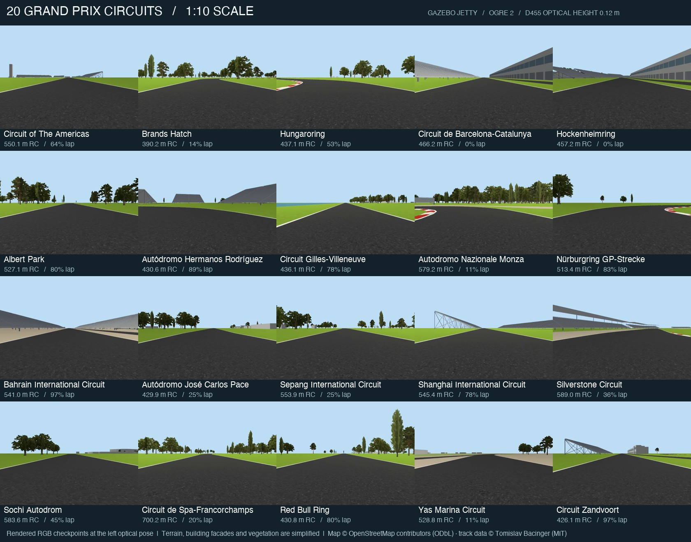

# Gazebo ステレオ走行の全20コース

Notebook ホストの `atd gazebo` から、F1TENTH の [2D ベンチマーク](../samples/f1tenth/README.md) に採用した20会場の全周を選べる。Gazebo の走路は各サーキットの地理座標を水平 1/10 にしたもの。カメラ台が指定の軌跡をたどるため、同じコース、同じ発着位置で D455 相当のステレオ画像を繰り返し取得できる。



各コマは Gazebo で左眼と同じ位置から撮影したカラー参考画像。VO にはモノクロの左右画像を使う。地理データは © OpenStreetMap contributors および Tomislav Bacinger。[沿道の地物・ライセンス](../tools/gazebo_monza/reference/scenery-sources.md)・[走路データの出典](../tools/gazebo_monza/reference/track-sources.md)

## 実行方法

NVIDIA GPU を備えた Ubuntu Notebook のホストで実行する。Gazebo 専用イメージの初回準備と、録画・実時間レート診断の詳細は [Gazebo セットアップ・操作手順](gazebo_monza.md) を参照する。

走行時は checkout 内の地理データと素材からシーンを生成する。対話端末で `atd gazebo` を開き、bag 記録、動画、地図作成、配信などの操作を選ぶ。全周ではコース・速度・周回数を、各走行ではステレオ解像度と IMU を選択できる。同じ設定を引数でも指定できる。

```bash
atd gazebo list
atd gazebo bag --course monza --speed 2.5 --laps 2
atd gazebo video --course spa --speed 3 --laps 3
```

Monza の例は 1/10 コース上の **2.5 m/s（シミュレーション時刻）で2周**して、1本の bag に記録する。約579.2 m の経路なので1周は約232秒、2周は約463秒。Spa の例は3周を通した `stereo.mp4`、`left.mp4`、`right.mp4` を `data/results/runs/gazebo/spa/<run-id>/` に保存する。Notebook 用の results 保存先を変更した場合はその下の `runs/gazebo/<コースID>/`、Monza は `runs/gazebo_monza/` を使用する。

| 引数 | 指定方法と既定の動作 |
|---|---|
| `--course ID` | `atd gazebo list` に表示される20コースから選ぶ。既定は `monza`。既存の `--circuit ID` も使える。 |
| `--speed m/s` | カメラ台が走行軌跡に沿って進む速さ。省略時は従来のコース別設定を使う。Monza 全周の既定は1周240シミュレーション秒、約2.41 m/s。 |
| `--laps N` | 正の整数。指定すると Monza でも自動で全周を選ぶ。動画・bag・地図は最終周のゴールで完了する。全周の `serve` は省略すると連続周回、指定するとその周回数で配信を終了する。 |
| `--resolution WxH` | 片眼あたり `424x240`、`640x480`（既定）、`848x480`、`1280x720`。左右ともシミュレーション時刻で90 Hz。 |
| `--imu off\|200\|400` | 既定は `off`。有効時は生の加速度200 Hzと生のジャイロ200または400 Hz、加速度・角速度を統合した IMU をジャイロと同じ周期で配信する。 |
| `--duration 秒` | 動画・bag・地図では1周または選択区間を走るシミュレーション秒数。速さを決めるには `--speed` とどちらか一方を使う。`benchmark`・`diagnose` では実時間の計測窓を表し、走行速度と別々に指定できる。 |

`video`・`run`・`serve` で Monza を選び、ルート・周回数を省略すると、従来どおり第1シケインの区間になる。`run` は動画の後にベンチマークを別途実行する。周回数は動画に適用され、ベンチマークは実時間の計測窓で終わる。

Montreal で cuVSLAM を試すときは、下記を別々の端末から起動する。最初の端末は左右の画像と CameraInfo の購読がそろうまでスタートで待つ。2 番目の端末は準備済みの Notebook 側 Isaac ROS 開発環境を使用する。

```bash
# 端末 1
atd gazebo serve --circuit montreal --wait-for-stereo
```

```bash
# 端末 2
atd bringup gazebo
```

`serve` はゴール後も次周へ進む。画像とカメラ台の時刻は Gazebo の `/clock` に対応する。実時間の左右ペア数と撮影時刻の間隔は `atd gazebo benchmark --circuit montreal` の `benchmark.json` で確認できる。

全コースの景観を短時間の動画で比較する場合は、次の操作で各1周を20シミュレーション秒に短縮して順に録画できる。通常速度で VO を試す際は `--duration 20` を外す。

```bash
atd gazebo list | while IFS= read -r circuit; do
    atd gazebo video --circuit "$circuit" --route lap --duration 20 || exit 1
done
```

## 1周でcuVSLAM地図を作る

### 1周を rosbag に記録して後で処理する

**Ubuntu Notebook ホスト**で Gazebo を指定周回（既定1周）走らせ、選択した解像度の左右の生画像（mono8）、左右の CameraInfo、車体とセンサーの固定 TF（`/tf_static`）を MCAP に記録する。IMU を有効にすると生の加速度・ジャイロと統合 IMU の3トピックも保存する。記録時刻は Gazebo の `/clock` に従う。初めて `bag` を使うときは、オンラインで一度 `prepare` して rosbag2 と MCAP の依存を用意する。

```bash
atd gazebo prepare
atd gazebo bag --circuit monza
```

Monza の既定は240シミュレーション秒。左右の画像本体だけで約13.27 GBになるので、記録先の SSD に余裕を確保する。他のコースは `atd gazebo list` に表示される ID を指定する。記録と検査が完了すると、標準配置では `data/record/rosbags/gazebo-<コースID>-<run-id>/` に bag が現れる。Notebook の記録先を変えている場合は、その直下の `rosbags/` に入る。

検査ではカメラ台が指定した回数だけ周回したことを実測姿勢で確認し、保存済みの左右画像と両 CameraInfo が指定解像度で同じ時刻の発着を覆うこと、固定 TF の基線と向きが正しいことを確認する。IMU を有効にした bag では3ストリームの時刻・座標系・収録状況も検査し、結果を `run.json` の `bag_audit.imu_streams` に残す。途中で同時刻の画像組が0.25シミュレーション秒を超えて途切れた場合は、その bag を保持し、端末と `run.json` に欠落を表示する。記録を中断した場合や必須入力が欠けていた場合は、`run.json` の `partial_bag` から未完成のデータを確認できる。

**後処理は Notebook の Isaac ROS 開発コンテナ**で行う。ホストで `atd dev` を実行して入室し、準備済みなら次を実行する。Web UI の初回準備には `atd-web prepare` を使う。[Web と ROS パッケージの準備](../apps/web/README.md#起動)

```bash
atd-web
```

1. Notebook の Chrome で「地図とライン」を開き、「rosbag から地図を作成」を選ぶ。記録前から画面を開いていた場合は、先に「マイライブラリ」の更新ボタンを押す。[Notebook の地図画面](http://127.0.0.1:8766/#map)
2. 「記録データ」で先ほどの `gazebo-monza-…` を選び、「新しい地図ID」に例えば `monza_01` を入力する。画像トピックと optical frame は Gazebo と画面の既定値が一致する。
3. 「cuVSLAM地図作成を開始」を押す。NVIDIA のオフライン処理が保存済みの bag を直接読む。成功すると `data/results/maps/monza_01/nvidia/cuvslam_map/` に地図ができる。同じ bag を使う次の試行では別の地図 ID を指定する。

地図作成時には Gazebo を終了してよい。あとから VGL 地図や表示用の点群を作成するときも元の bag を使うため、そのまま保存する。[VGL と点群の準備](../apps/web/README.md#map)

### 走行と同時に地図を作る場合

Gazebo 専用イメージを準備した Ubuntu Notebook で、Isaac ROS 開発コンテナを起動しておく。初回と `atd_bringup` の更新時は、開発コンテナ内でパッケージをビルドする。

```bash
# Notebook ホスト
atd dev

# 開いた ATD 開発コンテナ内
atd build --packages-up-to atd_bringup
```

**別端末の Notebook ホスト**で次を実行する。Gazebo とマッピング用の cuVSLAM が連携し、コースを1周して地図を保存する。Monza も `map` では既定で GP コースを1周する。対話操作では `atd gazebo` → `map` でコース・速度・周回数を選べる。複数周でも最終周のゴールで地図を1回保存する。

```bash
atd gazebo map --circuit monza
```

左右の `mono8` 画像・CameraInfo と固定 TF を直接 cuVSLAM に渡し、ステレオ VO で地図を作る。IMU 融合の効果は、`bag --imu 400` で記録してから [VO と VIO の再生手順](gazebo_monza.md) で比較できる。時計は `/clock`、DDS は既定で SHM を使う。Monza の既定は240シミュレーション秒。たとえば `--duration 300` では同じ周回路を300シミュレーション秒で走る。短い時間を指定するほどフレーム間の移動距離が増える。

開始・終了時の追跡と周回中の移動を確認する。途中で VO が失敗した場合や追跡状態・オドメトリの観測間隔が1シミュレーション秒を超えた場合は、前後の追跡と地図保存が成立していれば地図を保持する。このとき `mapping.json` の `save.tracking.coverage` は `interrupted` となり、最初に途切れた周回内の時刻を確認できる。

成功すると、Notebook の results 配下の `maps/gazebo-<コースID>-<run-id>/` に `nvidia/cuvslam_map/` と `mapping.json` ができる。実行ログと周回・追跡・保存の判定は run 側に残る。地図は NVIDIA 公式の保存サービスで書き出したランドマーク・ポーズグラフで、再測位の精度は別走行で評価する。Web UI で VGL を準備し、点群や HDMap まで作る従来手順には、元の bag とオフライン地図作成時の保存画像が別途必要になる。[cuVSLAM の地図保存と再測位](https://nvidia-isaac-ros.github.io/v/release-5.0/concepts/visual_slam/cuvslam/tutorial_isaac_sim.html)・[Notebook の地図作成手順](../apps/web/README.md)

### 動画・rosbag・地図作成の負荷

| 目的 | Gazebo のステレオ描画に加わる処理 | 保存する内容 |
|---|---|---|
| 景観を見比べる | `video` は同時刻の左右ペアを30 fpsにそろえ、CPUで左右をH.264圧縮する。録画後に横並び動画もエンコードする | 左・右・横並びのMP4 |
| 同じ観測で設定を変えて再解析する | `bag` は ROS メッセージを MCAP に書き込み、cuVSLAM の GPU 処理は記録後に実行する | 左右の生画像・CameraInfo・固定 TF と選択した IMU をシミュレーション時刻で収録した指定周回分の rosbag |
| 1周分の地図を得る | `map` は描画と cuVSLAM の特徴追跡・地図更新を並行して実行し、ゴールで地図を保存する | cuVSLAM 地図と検証記録。動画生成・bag記録は省く |

画像本体の目安は幅 × 高さ × 1 byte × 左右2枚 × 90 Hz × 走行シミュレーション秒数。全数記録した Monza の既定1周（240秒）なら、424×240 で約4.40 GB、640×480 で約13.27 GB、848×480 で約17.58 GB、1280×720 で約39.81 GB。IMU・CameraInfo・TF、MCAP の管理情報、発着時の待機分は別途加わる。実時間の書き込み速度はシミュレーションの進行率に比例する。同じ Notebook で3経路の CPU・GPU 使用率や処理時間を比較した値は未計測。

## 車載映像の検証

macOS のネイティブ Gazebo Jetty 10.7／OGRE 2 で、追加19コースをそれぞれ20シミュレーション秒で一周させた。全コースでカメラ台の実際の姿勢121点を経路と照合し、左右映像が出発とゴールを含むことを確認した。カメラは片眼640 × 480、光学中心高0.12 m、基線長0.095 m。Gazebo Transport で同じ撮影時刻の左右画像を計34,295組取得した。Monza は先に取得した60秒の全周映像と姿勢記録で確認している。新しい19コースの Notebook 上の ROS 2 受信レートと、cuVSLAM が追跡を維持できる区間は未計測。

## コース一覧

「公称」は公式の実コース長、「RC 一周」は Gazebo が使用する平面走行軌跡の長さ。左端の ID を `--circuit` に指定する。

| コース ID | レイアウト・景観 | 公称 (km) | RC 一周 (m) | 公式資料 | 走路座標 |
|---|---|---:|---:|---|---|
| `austin` | 反時計回り。第15ターンの観客席と展望塔。 | 5.513 | 550.06 | [2019 米国 GP](https://www.formula1.com/en/racing/2019/united-states) | [OSM](https://www.openstreetmap.org/relation/6537729/history/14) |
| `brandshatch` | 現行の森を巡る GP ロング。1986 年の F1 から改修あり。 | 3.916 | 390.15 | [現行 GP](https://www.brandshatch.co.uk/about/circuit-layouts) | [OSM](https://www.openstreetmap.org/relation/7218462/history/3) |
| `budapest` | Hungaroring の GP 本線と周囲の樹林。 | 4.381 | 437.12 | [2019 ハンガリー GP](https://www.formula1.com/en/racing/2019/hungary) | [OSM](https://www.openstreetmap.org/relation/284557/history/16) |
| `catalunya` | 2023 年以降の最終シケインなし。メインスタンドとピット棟。 | 4.657 | 466.21 | [2025 スペイン GP](https://www.formula1.com/en/racing/2025/spain) | [OSM](https://www.openstreetmap.org/relation/284540/history/15) |
| `hockenheim` | Parabolika とヘアピンを通り、観客席のある南区間へ戻る。 | 4.574 | 457.19 | [2019 ドイツ GP](https://www.formula1.com/en/racing/2019/germany) | [OSM](https://www.openstreetmap.org/relation/284588/history/7) |
| `melbourne` | 2022 年改修後の湖畔の GP 本線。湖と地図上の並木。 | 5.278 | 527.07 | [2025 豪州 GP](https://www.formula1.com/en/racing/2025/australia) | [f1-circuits](https://github.com/bacinger/f1-circuits/blob/8094e957b8d6aa8b9f4510c93968556cccd30e02/circuits/au-1953.geojson) |
| `mexicocity` | メインストレートからスタジアムの観客席の間へ。 | 4.304 | 430.60 | [2025 メキシコシティ GP](https://www.formula1.com/en/racing/2025/mexico) | [OSM](https://www.openstreetmap.org/relation/16251935/history/5) |
| `montreal` | ノートルダム島の本線。水際、林、ピット棟。 | 4.361 | 436.11 | [2019 カナダ GP](https://www.formula1.com/en/racing/2019/canada) | [OSM](https://www.openstreetmap.org/relation/284595/history/19) |
| `monza` | 両側の走路境界あり。第1シケインは区間指定も可能。 | 5.793 | 579.20 | [Monza GP](https://www.monzanet.it/en/circuit/) | [OSM・両境界](../tools/gazebo_monza/reference/README.md#走路の根拠) |
| `nuerburgring` | GP ロングのタイトな最終シケイン。Nordschleife は対象外。 | 5.148 | 513.39 | [2020 アイフェル GP](https://www.fia.com/sites/default/files/2020_eifel_grand_prix_preview.pdf) | [OSM](https://www.openstreetmap.org/relation/38567/history/35) |
| `sakhir` | 通常の GP 本線。砂地と Batelco 観客席。 | 5.412 | 541.02 | [2019 バーレーン GP](https://www.formula1.com/en/racing/2019/bahrain) | [OSM](https://www.openstreetmap.org/relation/284538/history/16) |
| `saopaulo` | 反時計回り。Senna S とインフィールドを通る。 | 4.309 | 429.92 | [2019 ブラジル GP](https://www.formula1.com/en/racing/2019/brazil) | [OSM](https://www.openstreetmap.org/relation/6781071/history/6) |
| `sepang` | 平行する2本のストレート、観客席、ピット棟。 | 5.543 | 553.89 | [2017 マレーシア GP](https://www.fia.com/sites/default/files/2017_malaysian_preview_1.pdf) | [OSM](https://www.openstreetmap.org/relation/284496/history/5) |
| `shanghai` | 巻き込む第1コーナーとバックストレート。水域と観客席。 | 5.451 | 545.36 | [2019 中国 GP](https://www.formula1.com/en/racing/2019/china) | [OSM](https://www.openstreetmap.org/relation/2094941/history/6) |
| `silverstone` | Hamilton Straight を出発。Arena 区間と Wing ピット棟。 | 5.891 | 589.00 | [2026 英国 GP](https://www.formula1.com/en/racing/2026/great-britain) | [OSM](https://www.openstreetmap.org/relation/51160/history/33) |
| `sochi` | 五輪公園を巡る旧 F1 ロング。背景は取得時点の地物。 | 5.848 | 583.57 | [2021 ロシア GP](https://www.formula1.com/en/racing/2021/russia) | [f1-circuits](https://github.com/bacinger/f1-circuits/blob/8094e957b8d6aa8b9f4510c93968556cccd30e02/circuits/ru-2014.geojson) |
| `spa` | La Source、Eau Rouge、Bus Stop。森林と Raidillon の観客席。 | 7.004 | 700.15 | [2019 ベルギー GP](https://www.formula1.com/en/racing/2019/belgium) | [OSM](https://www.openstreetmap.org/relation/284560/history/23) |
| `spielberg` | Remus へ向かう四輪 GP 本線。二輪用シケインは除外。 | 4.318 | 430.78 | [2019 オーストリア GP](https://www.formula1.com/en/racing/2019/austria) | [OSM](https://www.openstreetmap.org/relation/5309181/history/8) |
| `yasmarina` | 反時計回り。2021 年改修後。マリーナと観客席。 | 5.281 | 528.78 | [2025 アブダビ GP](https://www.formula1.com/en/racing/2025/united-arab-emirates) | [OSM](https://www.openstreetmap.org/relation/11378665/history/7) |
| `zandvoort` | 現代の GP ロング。砂地とピットストレート。 | 4.259 | 426.08 | [2025 オランダ GP](https://www.formula1.com/en/racing/2025/netherlands) | [OSM](https://www.openstreetmap.org/relation/13545573/history/11) |

## 再現した範囲

- **走路と標高**　走路は平面で、Spa の急勾配や Zandvoort のバンク角は省略している。Monza は左右の境界線から軌跡を求める。他のコースは地図の中心線に代表幅を与えて路面を作る。主な平面配置が同じでも幅、縁石の始終点・断面には近似を含む。[走路の出典・代表幅・ライセンス](../tools/gazebo_monza/reference/track-sources.md)・[Silverstone の地理資料](../tools/gazebo_monza/reference/silverstone.md)
- **発着地点**　地図にスタートまたはフィニッシュ位置があれば、その直線からレース方向に出発する。Budapest、Sakhir、Sochi、Yas Marina は公開点列の直線上の始点を基準にした概略位置。出典と取得版は各コースの `track.geojson` にある。[参照データ](../tools/gazebo_monza/reference/)
- **年代と背景**　Barcelona、Melbourne、Yas Marina は2D版の収録後に改修された GP 仕様を採用した。Sochi は F1 開催時の周回路に現在の景観を重ねる。沿道の建物・観客席・樹林・水域は地図にある地物を使用し、建物の外装や高さ、林内の個々の木、照明・材質は描画用の近似。仮設席など未収録の地物もある。[OSM の帰属](https://www.openstreetmap.org/copyright)
- **計測の用途**　`run.json` に周回判定、`scene/rig_motion.jsonl` にカメラ台の姿勢と時刻を保存する。録画時の左右ペアの時刻は `video.json`、受信計測時の時刻とレートは `benchmark.json` で確認できる。車両の操舵、タイヤ、ESC や Pure Pursuit を含む閉ループの走行比較には、既存の2Dベンチマークを使用する。[ステレオ試験の測定項目](gazebo_monza.md)・[2D 評価](../samples/f1tenth/README.md)
