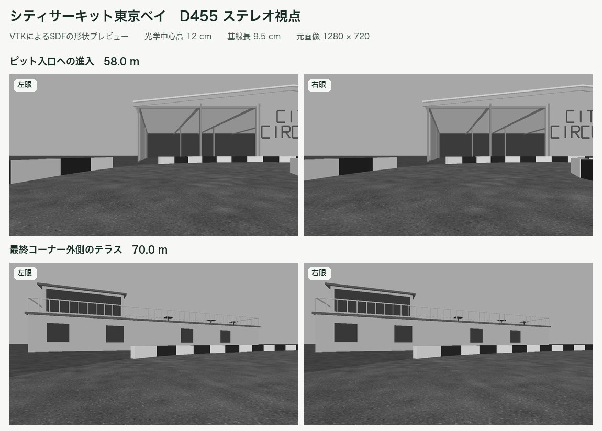
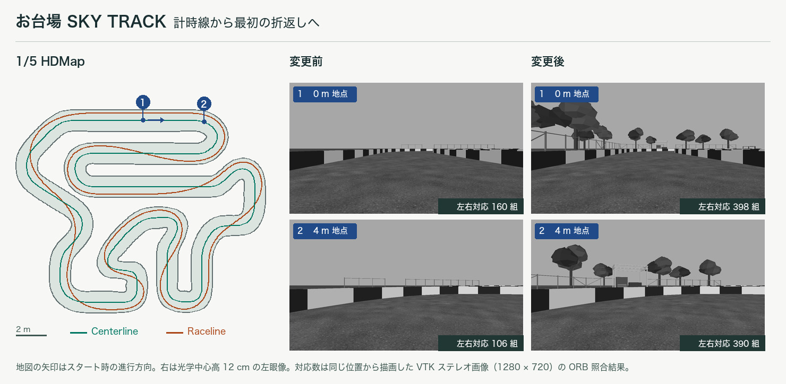

# お台場の Gazebo コースと地図作成

## お台場を2周して再訪時の追跡を確認する

`odaiba` はシティサーキット東京ベイの屋外 SKY TRACK。施設の走行ガイドから計時線・走行方向・中心線を読み取り、公称400 mを基準に1/5とした。代表幅は図から推定した1.4 m、平滑化したカメラ台の経路は1周79.66 m。3 m/sでは2周53.11シミュレーション秒、1280×720・30 Hzの左右生画像は走行区間で約2.94 GBになる。MCAPにはこれに発着前後のデータやメッセージ管理情報が加わる。[公式走行ガイド](https://city-circuit.com/beginners/)・[屋外コースの公称距離](https://city-circuit.com/private/)

ピット・テラス・ブリーフィングルームの位置は2025年12月の大会施設図を走行ガイドに合わせた。屋根の開口と柱、デッキの手すり、青白の低いバリアは施設写真を参考にした。建物の高さ・奥行き・支柱間隔は描画用の概算で、カメラは既存のRC車載設定（光学中心高12 cm、左右基線9.5 cm）を使う。[大会施設図](https://kart-ev-div.city-kart.jp/wp-content/uploads/2025/12/b93fd2f6f6482e8449159fbfb90ace03.pdf)・[屋外コースの写真](https://city-circuit.com/wp-content/themes/city-circuit/assets/img/home/facility01-1.jpg)・[テラスの写真](https://city-circuit.com/wp-content/themes/city-circuit/assets/img/home/facility05.jpg)



Notebook での再生試験では、2周走行時に3 m/sでループ閉じ込みを確認し、5 m/sでは確認できなかった（ユーザー報告）。3 m/s・2周を1280×720、30 Hzのステレオで記録するには、準備済みの Ubuntu Notebook ホストで次を実行する。メニューからは `atd gazebo` → `bag` → `odaiba` を選ぶ。

```bash
atd gazebo bag --course odaiba --speed 3 --laps 2 --resolution 1280x720 --camera-hz 30 --imu off
```

Notebook の Isaac ROS 開発コンテナで、次を実行する。`atd build` は初回、ワークスペースに `atd_bringup` を準備するときだけ実行する。bag の選択画面では `gazebo-odaiba` で絞り込み、先ほどの記録を選ぶ。

```bash
atd build --packages-up-to atd_bringup
atd replay --tracking vo
```

2周目のピット前で RViz の青い Gazebo 正解軌跡と橙の SLAM 推定軌跡を見比べる。ピンクの `Loop closure landmarks` は cuVSLAM が閉じ込み処理に使う点群。各周で最初に非空点群を観測した地点が端末に出る。[cuVSLAM の ROS 出力](https://nvidia-isaac-ros.github.io/v/release-5.0/repositories_and_packages/isaac_ros_visual_slam/isaac_ros_cuvslam/index.html)

bag の末尾で、同時刻の姿勢グラフの頂点・辺を、cuVSLAM の時刻付き姿勢と照合する。半周以上離れた別の周の姿勢を直接結ぶ辺があり、短い時間間隔の辺をたどっても両端がつながると、端末に「周回間の閉路を姿勢グラフで確認」と出る。表示された周回内距離と GT 上の隔たりから、コースのどの場所同士が結ばれたかを確認できる。よく似た隣のレーンを誤って結ぶ場合もあるため、青・橙の軌跡と合わせて読む。

端末に出る結果ディレクトリの `summary.json` に判定を保存する。`loop_closure_graph.status` は、閉路を確認した場合が `cross_lap_cycle`、照合できた範囲で見つからなかった場合が `not_observed`、データ不足などで照合できなかった場合が `unavailable`。点群の更新数と初出地点は `loop_closure_cloud` に保存する。[姿勢グラフの配信実装](https://github.com/NVIDIA-ISAAC-ROS/isaac_ros_visual_slam/blob/release-5.0/isaac_ros_cuvslam/src/impl/posegraph_vis_helper.cpp)・[時刻付き姿勢の取得実装](https://github.com/NVIDIA-ISAAC-ROS/isaac_ros_visual_slam/blob/release-5.0/isaac_ros_cuvslam/src/visual_slam_node.cpp)

## 実行方法

### 計時線から最初の折返しまで

計時線から約4 m進むと、最初の折返しに入る。進入側の外周に斜材のある柵、金属トラス、機材箱、奥行きの異なる樹木を配置し、折返しの島には長さ42 cmの低い柵を置いた。北ゲートとプレス区画を配置の目安にし、個々の物体の寸法・位置は推定した。[大会施設図](https://kart-ev-div.city-kart.jp/wp-content/uploads/2025/12/b93fd2f6f6482e8449159fbfb90ace03.pdf)・[屋外コースの写真](https://city-circuit.com/wp-content/themes/city-circuit/assets/img/home/facility01-1.jpg)



VTKで左右を描画した1280×720のモノクロ画像では、ORBの左右対応数が計時線で160→398組、4 m地点で106→390組、5 m地点で95→324組となった。照合には左右相互の最近傍比0.75、垂直ずれ1.5 px以内、水平視差1〜257 pxを用いた。cuVSLAMの追跡と閉路は、この景観で新しく収録したbagを再生して評価する。[同じ境界で2Dベンチマークを実行](simulation.md#お台場の同梱-hdmap-で走る)

### Gazebo の起動設定

準備済みの Linux Notebook では `atd gazebo` から操作・速度・周回数・解像度・撮影レート・IMU を選べる。コースIDは `odaiba`、ルートは全周の `lap`。発着の計時線を毎周同じ向きで通過する。[イメージの準備・動画・配信・診断](gazebo_monza.md)

| 設定 | 選択肢・単位 |
|---|---|
| `--speed` | RC車の m/s。お台場で省略すると1周33シミュレーション秒（約2.41 m/s） |
| `--laps` | 正の整数。動画・bag・地図の既定は1周。連続配信は省略すると Ctrl+C まで周回 |
| `--resolution` | 片眼の幅×高さ。424x240、640x480（既定）、848x480、1280x720 |
| `--camera-hz` | シミュレーション時刻で30、60、90 Hz（既定） |
| `--imu` | off（既定）、200、400。加速度は200 Hz、ジャイロと統合 IMU は指定した Hz |
| `--duration` | 動画・bag・地図では1周のシミュレーション秒数で、速度とどちらかを指定する。benchmark・diagnose では実時間の計測窓 |

## 1周でcuVSLAM地図を作る

### 記録した bag からオフラインで作成する

上記の `atd gazebo bag` で記録した2周のbagを使える。1周だけ記録する場合は `--laps 1` を指定する。Gazebo は左右の画像と CameraInfo、固定 TF をMCAPに保存し、走行後に各周の発着と時刻を検査する。IMUを選択した場合は生の加速度・ジャイロと統合 IMU も検査する。

確定した bag は Notebook の記録先の `rosbags/gazebo-odaiba-…`、走行ログは結果先の `runs/gazebo/odaiba/<run-id>/` に保存される。MCAP検査の詳細は `run.json` にある。bag 名には開始日時（日本時間）、解像度・撮影レート、IMU 設定、周回数、速度が入る。

Notebook の Isaac ROS 開発コンテナで `atd-web` を起動する。Chrome の「地図とライン」→「rosbag から地図を作成」で先ほどの bag を選び、「新しい地図ID」に例えば `odaiba_01` を入力して「cuVSLAM地図作成を開始」を押す。成功すると `/data/results/maps/odaiba_01/nvidia/cuvslam_map/` に保存される。後から VGL・点群・HDMap の処理にも元の bag を使える。[Notebook の地図画面と準備](../apps/web/README.md)

### 走行と同時に地図を作る場合

Gazebo 専用イメージを準備し、Notebook ホストで `atd dev` を実行して Isaac ROS 開発コンテナを起動する。コンテナ内で初回に `atd build --packages-up-to atd_bringup` を実行する。別端末の Notebook ホストで次を実行する。

```bash
atd gazebo map --course odaiba --speed 3 --laps 2 --resolution 1280x720 --camera-hz 30
```

Gazebo と cuVSLAM がステレオ通信・初期追跡を確認してから発進し、指定周回の最終ゴールで地図を保存する。結果先の `maps/gazebo-odaiba-<run-id>/` に地図本体と `mapping.json` ができる。途中の追跡に途切れがある場合は `save.tracking.coverage` を確認する。次に VGL 地図や点群・HDMap まで作る場合は、元の bag と保存画像を利用できるオフラインの手順を使う。[Notebook の地図作成手順](../apps/web/README.md)

## 保存地図とステレオ画像で閉ループ走行する

Notebook の Gazebo が計時線で静止した車両から左右の画像を配信する。Isaac ROS は VGL で初期位置を求め、cuVSLAM で保存地図上の位置を追跡する。Planner がその位置から前方の軌道と速度を出し、Pure Pursuit と FF＋PID の指令で車両が動く。次の画像はその車両位置から描画される。Gazebo の正解姿勢は周回・境界の採点に使う。

1. お台場の走行 bag を Notebook の Web UI「地図とライン」で選び、cuVSLAM 地図を作る。以下では地図 ID を `odaiba_1p5` とする。
2. 同じ地図で VGL 地図と対応する Notebook 用 engine を準備し、点群を取得する。点群に合わせてコース境界を編集し、閉路の速度付き Centerline、Raceline または Customline を保存する。同梱の2Dサンプルの座標は Gazebo 基準なので、保存地図と重ねるには位置合わせが必要になる。[地図とラインの操作](../apps/web/README.md)
3. Notebook ホストで `atd dev` を起動し、開いたコンテナ内で変更をビルドする。

```bash
atd build --packages-up-to atd_bringup
```

別の端末で、**Ubuntu Notebook ホスト**から起動する。`--speed` はラインに設定した目標速度の上限（m/s）。解像度は保存した VGL 地図から選び、撮影レートは既定で30 Hz。地図とラインを対話的に選ぶ場合は `atd gazebo closed-loop` を使う。

```bash
atd gazebo closed-loop --course odaiba --map odaiba_1p5 --line centerline --speed 1.5 --laps 2
```

同じ計時線から Raceline を試すときは `--line raceline` に切り替える。シミュレーションでの Pure Pursuit の最短先読み距離は Centerline・Customline が0.35 m、Raceline が0.65 m。同梱のお台場の Raceline は計時線中央から約0.49 mずれており、停止時にも先読み円とラインが交わるようにした。編集したラインに合わせて `--min-lookahead` で上書きできる。

車両は保存地図上で追跡が成立し、有効な計画・制御指令を受けると発進する。走行中の追跡喪失や指令途絶ではスロットルをゼロにして減速する。車両は前進用の運動学的自転車モデルで、既定のスロットル FF 表と操舵・速度応答はシミュレーション用の設定値。

端末に表示される `runs/gazebo/odaiba/<run-id>/` の `closed_loop.result.json` で完走周回数、周回タイム、境界への接触や停止理由を確認できる。`scene/rig_motion.jsonl` は Gazebo の車体姿勢と制御状態の時系列、`closed_loop.ros.log` は初期位置推定・追跡・制御のログ。初期化中に終了した場合は `closed_loop.host.json` にも理由が残る。
