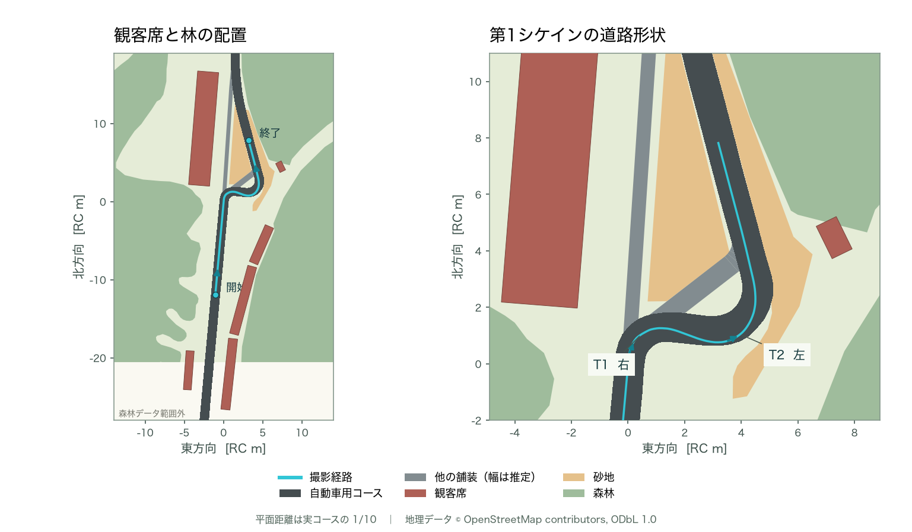
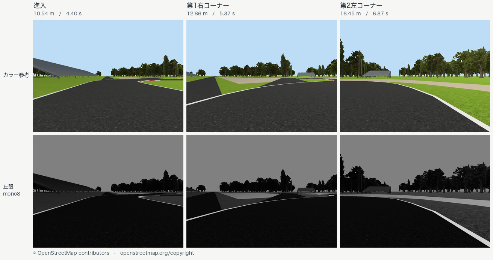
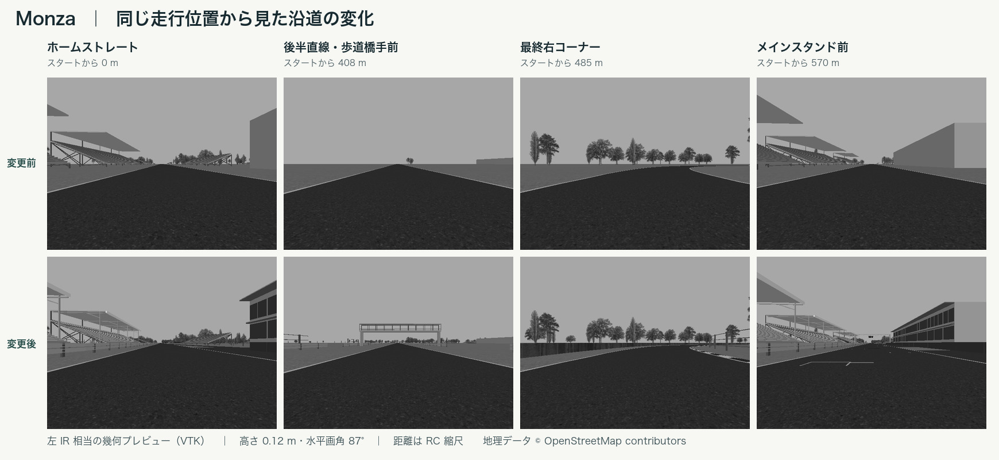
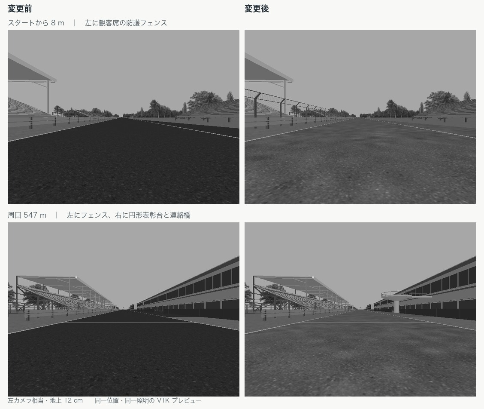
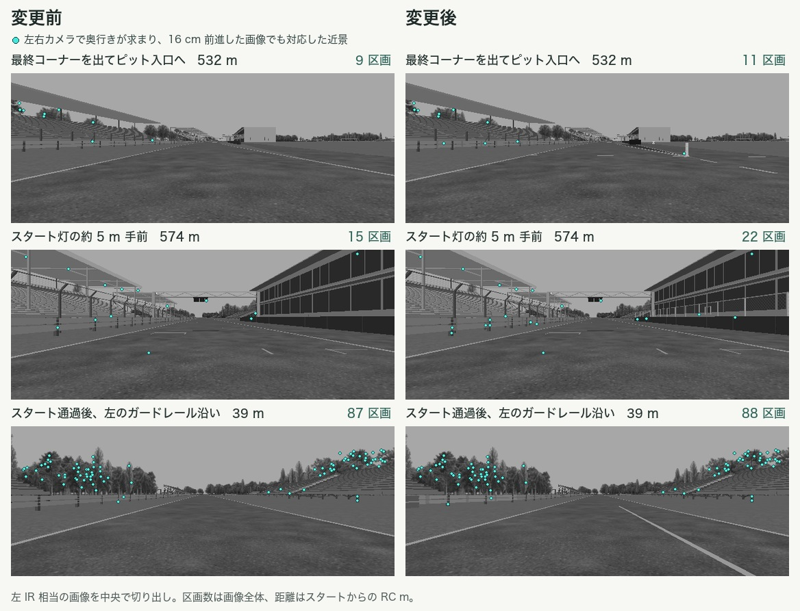
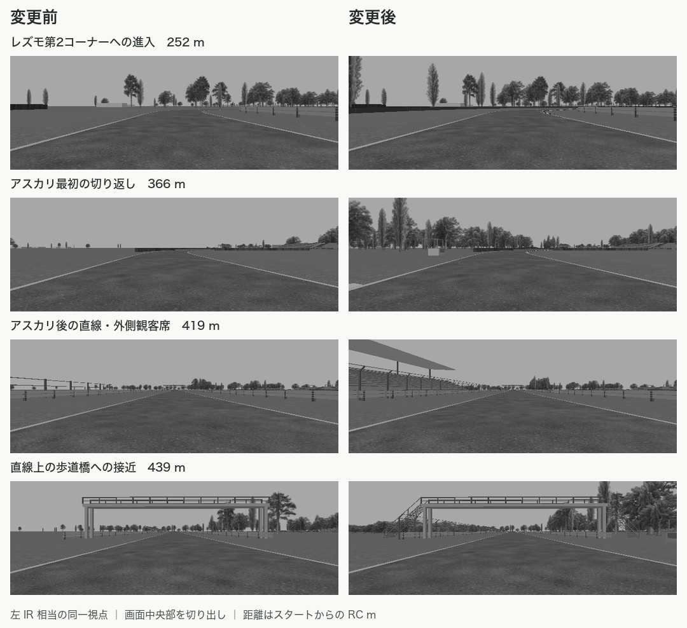

# Monza の D455 ステレオ試作

全20コースの一覧と出典は[F1サーキットの周回ガイド](gazebo_circuits.md)にあります。Notebook ホストで `atd gazebo list` を実行するとコースIDを確認できます。例として `atd gazebo video --circuit spa` はスパを1周して左右の車載動画を保存します。

モンツァの GP コースを周回する `lap` と、第1シケインを試す `chicane` を選べる。動画の既定は第1シケイン。地図作成用の `bag` は既定で GP コースを1周し、`--laps` で周回数を変更できる。

## 第1シケイン

ホームストレートを北へ進み、Variante del Rettifilo の右・左のシケインを抜ける区間を、水平距離 **1/10** の Gazebo シーンにした。カメラ台はシケインの実距離120 m手前から進入し、自動車用の約80 mの切り返しを通り、出口からさらに40 m進む。RC 上の走行距離は約24 m。基準にしたのは OpenStreetMap（OSM）の自動車用走路とコースの両縁で、2D ベンチマークには引き続きコンパクトな F1TENTH 版を使う。[モンツァ公式のコース解説](https://www.monzanet.it/en/circuit/)・[座標の出典・版・縮尺](../tools/gazebo_monza/reference/README.md)



| 要素 | 配置の根拠と再現範囲 |
|---|---|
| 走路 | OSM の自動車用走行経路と外周・内周の輪郭を投影した。白線は輪郭に沿わせ、赤白の縁石の範囲は内縁の曲がり方から推定した。測量済みの白線位置・縁石断面・路面勾配は反映していない。 |
| ランオフ | 砂地は地図にある2区画を描画。シケインを直進する舗装と二輪用の舗装は地図の中心線に沿わせ、幅をそれぞれ RC 上で0.50 m、0.72 mと仮定した。その他の地面は芝を基本にした。 |
| 観客席 | 地図にある6件の平面輪郭を使い、公式の場内図・設備表で確認できる 6A/B/C、8A/B、8 BIS の屋根なしの外観を採用した。高さ・段数・座席の色は推定。地図上の無名の建物と公式の席番号の対応は未確認。 |
| 林 | 地図に記録された林の輪郭・抜けに沿わせた。各樹木の座標・樹種・高さ、舗装と芝の材質や季節・照明はシミュレーション用の設定。 |
| 画面に含まれない設備 | コース脇の連続したガードレール・金網、仮設広告、スクリーンの正確な位置や高さは未確認。 |

平面座標の出典は **© OpenStreetMap contributors**。第1シケインの `scene/scene.json` には `scenery: monza_prima_variante_osm`、地理原点、縮尺、地理データの SHA-256 を保存する。全周では `scenery: monza_gp_osm` と追加の景観データの SHA-256 も記録する。[OSM の帰属とライセンス](https://www.openstreetmap.org/copyright)・[主催者の観客席図・設備表](https://www.monzanet.it/wp-content/uploads/2026/03/GP_F1_2026_LISTINO_PREZZI_3_2-2.pdf)・[素材の出典](../tools/gazebo_monza/materials/README.md)



実コースとの目視比較には、2024年の路面改修後に収録された2025年イタリア GP の車載映像を使える。メインストレート終盤から最初の右・左までが対応区間。F1 車載カメラと RC の D455 では視点高と画角が異なる。[Formula 1 公式オンボード映像](https://www.formula1.com/en/video/onboard-verstappens-record-breaking-2025-pirelli-pole-position-award-lap-at-monza.1842533699043908444)

## GP コースを1周する

準備済みの Ubuntu Notebook ホストで、スタートからゴールまでの左右動画を撮影する。

```bash
atd gazebo video --route lap
```

速度と周回数も変更できる。例えば `atd gazebo bag --course monza --speed 2.5 --laps 2` で、RC コースを 2.5 m/s で2周して1本の bag に記録する。対話端末では `atd gazebo` から選べる。[コース・速度・周回数の指定](gazebo_circuits.md#実行方法)

公開地図の GP コース両縁から生成した経路を、スタート／フィニッシュ地点から時計回りに一周する。水平縮尺 1/10 で **579.20 m**、既定は **240 シミュレーション秒**（平均約2.41 m/s）。録画用カメラ台は、開始位置で左右画像と CameraInfo の時刻がそろうのを待ち、一周するとゴールで止まる。録画時に `--duration 120` を加えると120シミュレーション秒で同じ距離を進む。[走行線の作成方法](../tools/gazebo_monza/reference/README.md)

ホームストレートにはピットの窓・庇、観客席の支柱、信号ガントリーとグリッドを配置した。後半直線は両側のレールと歩道橋、最終右コーナーは内側のフェンス・縁石と外側の砂地・壁が見える。左右カメラの描画上限を45 mから100 mに延長し、遠景の建物112棟と林を加えた。橋の位置は OSM の高架線に基づく。沿道設備の一部は写真と走路形状から補い、該当する区間を地理データに記録した。[地物別の出典と推定範囲](../tools/gazebo_monza/reference/lap-scenery.md)



全周の本線・ピット・分岐には灰色の舗装を使い、細かな骨材と緩やかな色むらを同じ地面の位置に描く。ホームストレートでは、左のガードレールと観客席の間に金網と上端が曲がった支柱が並ぶ。周回終盤には右のピット棟から張り出す円形表彰台と連絡橋が見える。通信マスト2基を含む設備の配置根拠と推定寸法は[沿道景観の資料](../tools/gazebo_monza/reference/lap-scenery.md)に記録した。



比較画像は左 IR カメラ相当の視点（高さ 0.12 m、水平画角 87°）で、生成した SDF メッシュを同じ照明の VTK で描画した。OGRE 2 と実機 D455 では明暗が変わる。ホームストレートの改修時点で全周の静的メッシュは 114,088 から 118,455 三角形になった。Notebook での再生比較には、ホストで `atd gazebo bag --circuit monza` を実行し、`atd replay` の一覧から新しい記録を選ぶ。以前の bag には撮影時の景観が入っている。

直線の 4・12・20・32・45 RC m で、左右のモノクロ画像と前進後の左画像（2.41 m/s、1/90 秒後）に共通する SIFT 特徴を調べた。距離比 0.75 で対応を選び、上下視差と既知の移動に整合する点を集計した。手前中央の路面（640 × 480 画像の x=110–530、y=275–435）では平面の予測視差とも照合した。5地点合計の路面の対応は 2 → 9、全画面は 870 → 813 だった。cuVSLAM の前進距離と追跡状態は Notebook で生成した bag で検証する。

`run.json` の `motion.lap_completed` は、物理更新後の実位置が経路に沿って進みゴールに戻ったかを示す。同じ `motion` 内の `video_endpoints_covered` は録画に使った左右ペアの時刻が発着を含むかを表す。左右動画は `stereo.mp4`、途中で前のフレームを再表示した回数・受信間隔は `video.json` に残る。スタートとゴールで同じ画像が撮れても、それだけで完走とは判定しない。

### ホームストレートの再訪を確認する

ピット入口と出口の白線・ボラード、ピット進入路の 80 km/h 標識、グリッド6番・21番の撤去ゲート、ピットボードを出す窓を再現した。観客席側にはガードレールの継ぎ板と退避口がある。設備の種類と位置関係は競技資料・地図に基づき、継ぎ目の間隔や個々の窓・標識の位置は近似した。[FIA の写真と配置を使った箇所](../tools/gazebo_monza/reference/lap-scenery.md)



同じカメラ姿勢・照明の VTK 描画でホームストレートを3 RC m間隔で調べた。640×480 の左右画像で SIFT を相互照合し、奥行き 0.5–10 RC m、上下ずれ1 px以内、前進後の再投影誤差2 px以内を満たす対応を 8×8 px の区画ごとに数えた。再訪の比較では、その地点でカメラを左へ4 cm、ヨーを左へ1.5°ずらした画像を使った。

| 区間（各20地点） | 16 cm前進しても対応した区画の中央値 | その最少値 | 位置・向きをずらして再訪した場合の中央値 |
|---|---:|---:|---:|
| ゴール手前 520–577 RC m | 15 → 15 | 6 → 7 | 18.5 → 19 |
| スタート後 0–57 RC m | 50 → 48.5 | 10 → 10 | 49 → 50.5 |

スタート灯手前では574 mが15 → 22、577 mが31 → 39区画になった。ピット入口の532 mでは右半分にも1区画が対応したが、538 mでは全画面で改修前後とも7区画だった。静的メッシュは全周で155,171 → 163,290三角形。画像上で対応する近景と、実際にcuVSLAMが前進を追跡・閉合できるかは別途比較する。

1周の記録ではスタート灯へ戻った直後にカメラ台が止まる。最初に撮影した直線をもう一度前進しながら観察するには、Notebook ホストで次のように2周を記録し、再生メニューからその bag を選ぶ。画像部分の容量目安は2周・2.5 m/sで約26 GB（640×480 mono8 の左右を90 Hzで欠落なく記録した場合）。

```bash
atd gazebo bag --course monza --speed 2.5 --laps 2
atd replay
```

RViz の緑は地図ランドマーク、橙は時刻ごとの SLAM 軌跡。ピンクの **Loop closure landmarks** は cuVSLAM が公開するループ閉じ込み関連の点群で、スタート付近の再訪時にどこに現れるかを観察できる。閉じ込み成功を表すフラグはこの表示にはない。既存の bag も新しい RViz 設定で見直せる。[Isaac ROS の可視化トピック定義](https://github.com/NVIDIA-ISAAC-ROS/isaac_ros_visual_slam/blob/e4dc8f59816dfca387bcb92364ecaf9207216475/isaac_ros_cuvslam/src/visual_slam_node.cpp#L257-L272)

### レズモからアスカリ、アルボレート手前まで

レズモでは、右の縁石と出口左の縁石、砂利の奥のタイヤバリア、進入と出口のマーシャル灯を区別して配置した。アスカリ進入右の 100 m 板からは下がった縁石が続き、シケイン本体では縁石が左・右・左と入れ替わる。走路周辺の林縁は OSM と ESA WorldCover 2021 の樹木被覆から補った。個々の樹木と設備の寸法は推定で、2023年の風害後の植生とは差があり得る。[設備の配置根拠](../tools/gazebo_monza/reference/lap-scenery.md)・[ESA WorldCover 2021](https://doi.org/10.5281/zenodo.7254221)

アスカリを出ると、右の旧 Junior コースが本線へ合流する。左の防護フェンスと両側のガードレールに沿って進むと、階段の付いた歩道橋が周回 413 m と 442 m に見える。2本の橋の間では、2025年に新設された外側の観客席 Rettilineo Parabolica Esterna が左手に見える。その先は左の低木帯と右の林縁に景色が変わる。最終コーナーに近づくと両側に実寸表記の 150・100・50 m 板が並ぶ。FIA の略図から読み取ったマーシャルポストと灯火盤の位置には誤差がある。[FIA の2026年コース変更 §27](https://www.fia.com/system/files/decision-document/2026_italian_grand_prix_-_race_directors_competition_notes_v2.pdf)・[各設備の参照資料](../tools/gazebo_monza/reference/monza_ascari.geojson)



次の値は同じ走行位置・照明で生成した 640×480 のモノクロ画像での比較。左右画像の両方と、そこから約 16 cm 前進した左画像（2.41 m/s、90 Hz の6フレーム後）に現れる近景を数えた。SIFT の相互照合で距離比 0.75、上下視差 1 px 以内、ステレオ奥行き 0.5〜10 RC m、既知のカメラ運動での再投影誤差 2 px 以内を条件にした。同じ模様を重複して数えないよう、左画像の 8×8 px の区画ごとに一票とした。

| 区間（スタートからの RC m） | 地点数 | 近景が対応した区画数の中央値（前 → 後） | 最少（前 → 後） |
|---|---:|---:|---:|
| レズモ 216–268 m | 14 | 95 → 101 | 0 → 7 |
| アスカリ 358–390 m | 9 | 26 → 76 | 1 → 34 |
| 出口後の直線 394–479 m | 18 | 6.5 → 18 | 1 → 2 |

直線では 419 m が 1 → 11 区画、434 m が 1 → 20 区画になった。424・429 m は各4区画、最終コーナー手前の 469 m は2区画で、まだ近景が疎な地点がある。全周の静的メッシュは 118,455 → 155,171 三角形。cuVSLAM の追跡状態と推定距離、OGRE 2 の描画速度は Notebook で新しい bag を記録して確認する。

アスカリ後の走行線について、395–479 RC m の両端を結ぶ直線からの最大の横ずれはモデルで約11.6 cm、中央の410–470 RC mだけでは約2.0 cm。OSMの左右の走路縁から独立に求めた中心もそれぞれ約11.4 cm、約2.0 cmになる。この値は地図を水平投影したシミュレーターの形状で、実コースの測量値や cuVSLAM の推定誤差とは区別する。[走路と座標の出典](../tools/gazebo_monza/reference/README.md)

## Notebook で再生・測定する

NVIDIA GPU と NVIDIA Container Toolkit が使える Ubuntu の Notebook ホストで、ATD のルートから実行する。Notebook ホストの `atd` メニューからも `gazebo` を選べる。

```bash
./scripts/gazebo.sh prepare
./scripts/gazebo.sh run
```

`prepare` は初回・Dockerfile 更新時にオンラインで実行する。ROS 2 Lyrical と Jetty の配布パッケージから専用イメージを作り、容量の明細を出力する。以降はコース・画像素材・プログラムを clone から読めるためオフラインで使える。既存の Isaac ROS 開発コンテナを起動する必要はない。Gazebo はサーバーモードで OGRE 2 の EGL 描画を使う。[公式の対応構成](https://gazebosim.org/docs/jetty/ros_installation/)・[Gazebo のヘッドレス描画](https://gazebosim.org/api/sim/10/headless_rendering.html)

`run` は動画用と速度計測用にシミュレーションを最初から個別に実行する。端末に各試行の保存先が出る。標準では `data/results/runs/gazebo_monza/`。保存先を設定済みなら Notebook 用 results の同じ相対位置に保存する。

| 操作 | 成果物 |
|---|---|
| `prepare` | `storage.json`、ビルド前後の `docker system df -v` と `docker buildx du`、`build.log` |
| `video` | `stereo.mp4`（左目／右目の横並び）、`left.mp4`、`right.mp4`、`video.json` |
| `bag` | 指定周回分（既定1周）のステレオ MCAP。完了後、Notebook の `data/record/rosbags/` から Web UI で選択できる |
| `benchmark` | `benchmark.json` に実時間で受信したペア数・Hz、シミュレーション時刻のHz、欠落・重複、最大到着間隔 |
| `diagnose` | 既定20実秒間の ROS 受信を `benchmark.json`、同じ時間帯の Gazebo Transport での左右受信と world 時刻を `gz_probe.json` に記録 |
| 両試行 | `run.json`、`scene/scene.json`、台の実際の位置 `scene/rig_motion.jsonl`、サーバー・ブリッジ・受信側のログ |

`stereo.mp4` を Notebook のブラウザにドラッグすると、左右を同時に再生・シークできる。実時間の配信と独立に、動画は同じタイムスタンプを持つ左右画像をシミュレーション時刻で30 fpsにサンプリングする。第1シケインの動画の既定長は10秒。受信が滞り前のペアを保持した動画フレームの数は `video.json` の `held_video_frames` で確認できる。

## 記録済みのステレオ bag を RViz / Foxglove で見る

Ubuntu Notebook のデスクトップで使う。初回はホストで `atd dev --build` を実行して RViz を含む開発コンテナを起動し、その中で `atd build --packages-up-to atd_bringup` を実行する。すでに開いているコンテナで `command -v rviz2 && ros2 pkg prefix rviz_default_plugins` が通れば、その中では ROS パッケージのビルドだけで試せる。以降はホストまたは起動済みの対応コンテナで次のコマンドを使う。

```bash
atd replay
```

一覧から bag を選ぶと、cuVSLAM と RViz が起動する。左右の画像・CameraInfo と車体から両カメラへの静的 TF を記録から確認し、購読の準備が整ったところで 0.5 倍速の再生を開始する。RViz は左右の IR 画像を Best Effort で購読し、`map` 座標でのランドマークと軌跡も表示する。bag の末尾でも画面は開いたままで、RViz を閉じるか端末で Ctrl+C を押すと一式が終了する。地図はメモリ上で生成される。

Gazebo の bag を選ぶと、RViz に次の3つが表示される。

| RViz の表示 | 読み方 |
|---|---|
| 青の **Gazebo ground truth** | Gazebo の物理ステップ後に測った後輪軸の軌跡。再生時計 `/clock` に沿って伸びる。 |
| 橙の **SLAM trajectory** | ステレオ画像から cuVSLAM が推定した `map` 内の車体軌跡。 |
| 白の **Position error at latest estimate** | 直近の推定位置と、その**画像時刻**の正解位置を結ぶ。線の長さが位置誤差で、追跡が途切れると最後に比較できた時刻の線が残る。 |

正解の記録区間で最初の有効な cuVSLAM 姿勢を受け取ると、その画像時刻に正解を補間し、初期位置と向きを一度だけ合わせる。以降は縮尺と変換を固定する。処理遅延があると青と橙の先端が示す時刻は異なるため、同時刻のずれは白線で読む。正解の配信先は `/atd/replay/ground_truth_path`、白線は `/atd/replay/position_error`。

新しい `atd gazebo bag` は通常シミュレーション時間で 20 Hz を目安に正解を記録し、bag に `atd_ground_truth/rig_motion.jsonl` を同梱する。既存の Gazebo bag でも、元の名前の bag と、同じ試行の `run.json` および `scene/rig_motion.jsonl` が Notebook の結果ディレクトリに残っていれば自動で照合する。Monza の保存先は `/data/results/runs/gazebo_monza/<run-id>/`、他コースは `/data/results/runs/gazebo/<circuit>/<run-id>/`。古い記録では正解のサンプル間隔が約 0.5 秒になることがあり、コーナーのサンプル間は直線補間される。正解が見つからない場合は端末にその旨を表示し、推定軌跡を再生する。

`atd replay --rate 1` で等速になる。bag 名を指定する場合は `atd replay "親ディレクトリ/bag名" --rate 0.5` のように `/data/record/rosbags/` からの相対パスを渡す。コンテナ内の絶対パスも使える。再生用の domain は既定 75（`ATD_REPLAY_ROS_DOMAIN_ID` で変更可）。専用の Fast DDS 設定と bag の `/clock` を使う。

`Failed to track: Timestamps are non-monotonic` が続いてRVizの表示が点滅する場合は、再生中に別端末の Notebook の Isaac ROS コンテナで次を実行する。通常、オドメトリの配信元は `/visual_slam` の1つ。再生前に同名のトラッカーを2つ検出した場合、`atd replay` は競合を報告する。

```bash
export ROS_DOMAIN_ID=75
export FASTDDS_DEFAULT_PROFILES_FILE=/workspaces/atd/docker/gazebo_monza/fastdds.xml
ros2 topic info /visual_slam/tracking/odometry --verbose --no-daemon
```

同じbagを別の空いているdomainで比較するには `ATD_REPLAY_ROS_DOMAIN_ID=76 atd replay` を使う。ログを照合する際は `ros2 launch` が表示した `component_container_mt` の PID とログファイル名の PID を合わせる。

`_NODE_NAMESPACE_UNKNOWN_/_NODE_NAME_UNKNOWN_` は、DDS が配信を検出し、その配信元を ROS ノードとまだ対応付けられていない状態。再生開始時は名前の解決を待ち、実際に別の配信元を確認した場合は名前を表示して再生を止める。待機中に調べるには、端末に表示された診断コマンドを別の Notebook コンテナ端末で実行する。Gazebo の既定 domain は 74、replay は 75。終了後に通常のシェルで実行した `ros2 topic list` とは、探索する時刻や domain が異なる。[ROS 2 の配信元名の実装](https://github.com/ros2/rmw_dds_common/blob/lyrical/rmw_dds_common/src/graph_cache.cpp#L514-L533)

### Notebook UI で区間別の誤差を見る

Notebook の Isaac ROS コンテナで変更反映時に `atd build --packages-up-to atd_bringup` と `atd-web build` を実行する。Web 環境を初めて準備する場合は `atd-web prepare` を使う。GT のある bag を `atd replay` で再生すると、比較結果が自動で `/data/results/runs/replay/<実行ID>/` に保存される。再生ごとに新しい ID が付く。

`atd-web` を起動し、**VSLAM 軌跡誤差** で結果を選ぶ。グラフ上で誤差が増え始める地点をクリックすると、コース図にもその地点の正解と推定が表示される。逆にコース図からグラフの地点を選ぶこともできる。

`atd replay` と `atd gazebo map` は、既定で cuVSLAM の姿勢グラフの保持数を無制限（`slam_max_map_size=0`）にする。同じ bag のホームストレート再訪時の誤差を比較するには、再生速度をそろえ、2回目の `atd replay` に `--slam-max-map-size 300` を付ける。結果一覧には各回の地図上限が表示される。設定を記録していない旧結果は「地図上限 未記録」と表示する。

- **進行方向 (m)** は同じ画像時刻の「推定位置 − 正解位置」を正解車体の前方に射影する。正なら実際より先に、負なら手前に推定している。
- **横方向 (m)** は走行方向に対して左が正。**向き (°)** は正解に対して反時計回りが正で、±180°の範囲で表す。
- Monza のアスカリ後は計時線から約 390–480 m、ホームは約 524 m から計時線を通って次の約 60 m まで。どちらもシミュレーターの 1/10 コース上で切り出した範囲。ホームはスタート直後、周回をまたぐ通過、最終ゴール手前を選べる。
- GT は全走行を表示する。対応する推定が 0.25 秒を超えて途切れた箇所では誤差の線を分ける。中断した再生では未再生区間にも推定値がない。古い bag に周回情報を対応付けられない場合は、累積距離で表示する。

保存物は `summary.json`（bag・再生速度・終了状態）、`reference.json`（時刻付き正解軌跡）、`samples.jsonl`（画像時刻・同時刻の正解と推定・符号付き誤差）。再生完了は bag の末尾に到達したことを表す。

### 手動で RViz または Foxglove を使う場合

ビューアや再生の起動を個別に操作したい場合は、同じコンテナの3端末それぞれに次を設定する。

```bash
export ROS_DOMAIN_ID=74
export FASTDDS_DEFAULT_PROFILES_FILE=/workspaces/atd/docker/gazebo_monza/fastdds.xml
```

端末1は `ros2 launch atd_bringup bag_vslam.launch.py`。cuVSLAM を `component_container_mt` にロードする。ログに `Loaded node '/visual_slam'` が出たら準備完了。

端末2は RViz の場合、次の ATD 設定を使う。Foxglove の場合は `ros2 launch foxglove_bridge foxglove_bridge_launch.xml address:=127.0.0.1 port:=8765 use_sim_time:=true` を起動し、Notebook のアプリで `ws://127.0.0.1:8765` に接続する。3D の基準フレームは `map`、点群は `/visual_slam/vis/landmarks_cloud`、軌跡は `/visual_slam/tracking/slam_path`。画像は `/camera/camera/infra1/image_rect_raw` を選ぶ。

```bash
rviz2 -d "$(ros2 pkg prefix --share atd_bringup)/config/bag_vslam.rviz" \
  --ros-args -p use_sim_time:=true
```

端末3で bag を選んで再生する。0.5倍速で開始し、シミュレーション時刻とカメラの静的 TF は bag から供給する。

```bash
bag_meta=$(find /data/record/rosbags -name metadata.yaml -type f | sort | fzf --prompt='再生する bag > ')
if [[ -n "$bag_meta" ]]; then
  ros2 bag play "${bag_meta%/metadata.yaml}" --clock --rate 0.5 \
    --qos-profile-overrides-path /workspaces/atd/ros2_ws/src/atd_mapping/config/replay_qos.yaml \
    --topics /tf_static /camera/camera/infra1/{image_rect_raw,camera_info} /camera/camera/infra2/{image_rect_raw,camera_info}
fi
```

## Gazebo の時刻で cuVSLAM を起動する

**1周を記録して後から地図を作る場合**は、Notebook ホストで `atd gazebo bag --circuit monza` を実行し、完了後に Notebook の Web UI「地図とライン」で bag を選ぶ。走行中に地図を作りたい場合は `atd gazebo map --circuit monza` を使う。以下の `serve` と `bringup gazebo` は連続走行中のステレオ VO を観測する操作。[記録とオフライン地図作成の手順・保存容量](gazebo_circuits.md#1周でcuvslam地図を作る)

Ubuntu Notebook で ATD 開発コンテナ（`atd dev`）を起動しておく。今回の変更を Notebook の checkout に反映した後、初回は次のコマンドで launch をインストールする。Gazebo の専用イメージは `atd gazebo prepare` 済みのものを使える。

```bash
atd build --packages-up-to atd_bringup
```

**端末1・Notebook ホスト**で Gazebo を起動する。左右の画像と CameraInfo に対応する購読がそろうまで世界を一時停止する。

```bash
atd gazebo serve --route lap --wait-for-stereo
```

**端末2・同じ Notebook のホストまたは ATD 開発コンテナ**でステレオ VO を起動する。地図や D455 実機の接続は不要。

```bash
atd bringup gazebo
```

全周ではゴールを越えると同じ向きで次周に入り、`/clock` は単調に進む。第1シケインを往復するには `--route chicane` を選ぶ。左右画像・CameraInfo の時刻は Gazebo の撮影時刻。cuVSLAM とその component container は `use_sim_time=true` で動作し、`/visual_slam/tracking/odometry` と `odom → base_link` の TF を出力する。例えば実時間1秒で `/clock` が0.47秒進むと、姿勢と速度の時間軸も0.47秒進む。実時間の90 Hz達成は起動条件に含まれない。今回は画像による相対姿勢推定を対象とし、車両 I/O は Jetson 側の従来の profile が担当する。[ROS 2 の時計](https://design.ros2.org/articles/clock_and_time.html)

両端末は既定で ROS domain 74 を使用する。変更時は両方で同じ `ATD_GAZEBO_ROS_DOMAIN_ID` を設定する。連続配信では Gazebo と Isaac に同じ SHM＋loopback の Fast DDS プロファイルを適用し、Isaac ROS CLI 標準構成に合わせて host network と IPC を共有する。動画・計測は従来どおり専用コンテナの IPC で完結する。[Isaac ROS CLI の起動設定](https://github.com/NVIDIA-ISAAC-ROS/isaac-ros-cli/blob/main/scripts/run_dev/run_dev.py)・[Fast DDS の Docker 通信](https://fast-dds.docs.eprosima.com/en/3.x/docker/shm_docker.html)

**別端末の Notebook ATD 開発コンテナ**で、シミュレーション時計の有効化・進行と VO の出力を確認できる。

```bash
export ROS_DOMAIN_ID="${ATD_GAZEBO_ROS_DOMAIN_ID:-74}"
export FASTDDS_DEFAULT_PROFILES_FILE=/workspaces/atd/docker/gazebo_monza/fastdds.xml
ros2 param get /visual_slam use_sim_time
ros2 topic echo /clock --once
ros2 topic echo /visual_slam/status --once
ros2 topic echo /visual_slam/tracking/odometry --field header.stamp --qos-reliability best_effort --once
```

終了は両端末で Ctrl+C。Gazebo を起動し直すと `/clock` はゼロから始まるので、VO も新しいセッションで起動する。`atd gazebo serve` 単独なら購読を待たずに配信する。

### 取付高・時間を変える

```bash
./scripts/gazebo.sh video --camera-height 0.14 --camera-pitch-deg 3
./scripts/gazebo.sh benchmark --duration 60
```

`--camera-height` は床から光学中心までの m。初期値は **0.12 m**、後軸から前方に 0.18 m、水平と仮定している。軸中心高さの仮定値は 0.0325 m。車体設定の後輪軸基準の z と区別する。左右の基線は公称 0.095 m、水平画角は公称 87°、640 × 480 の `mono8` 理想ピンホールカメラ。実機の取付高と個体別キャリブレーションは未測定。モノクロ画像は可視光材質の描画で、D455 の投光パターン、露出制御、振動による像の変化までは再現していない。[実車の座標定義](vehicle_layout.md)・[D455 仕様](https://realsenseai.com/products/stereo-depth-camera-d455/)

動画の `--duration` は1周または選択区間を走るシミュレーション秒数。全周動画は `--laps` で周回を増やせる。ベンチマークの `--duration` は実時間の計測窓で、走行速度は `--speed` で独立に選べる。移動は地図上の走路中心付近をたどる軌道再生で、映像と配信の検証用。タイヤや ESC、制御器による閉ループ走行の比較は既存の [2D シミュレーター](simulation.md) で行う。

### 左右画像の受信が遅いとき

Notebook ホストで次を個別に実行する。先の試行の終了コードが2でも次を実行できる。イメージを準備済みなら、この診断と DDS 設定は checkout の更新で使える。

```bash
atd gazebo diagnose --dds udp
atd gazebo diagnose --dds shm
```

両方とも同じシーン・計測時間を使う。`udp` は UDPv4 loopback、`shm` は Fast DDS の共有メモリも使える設定で、動画・計測・連続配信の既定値。動画・計測では Gazebo コンテナ専用の `/dev/shm` 上限を128 MiBにする。`serve` では Isaac ROS と IPC を共有し、別コンテナの cuVSLAM にも共有メモリで画像を渡せる。[Fast DDS の SHM transport](https://fast-dds.docs.eprosima.com/en/3.x/fastdds/transport/shared_memory/shared_memory.html)

| 診断に表示される結果 | 確認する箇所 |
|---|---|
| Gazebo 側ですでに映像が少なく、world 時刻もゆっくり進む | `gz_probe.json` の `world.real_time_factor`。1.0 が実時間相当。描画とシミュレーション全体の負荷を確認する |
| Gazebo 側は左右とも十分届き、ROS で片眼または両眼の枚数が落ちる | ブリッジ、DDS、ROS 購読処理。2回の結果で共有メモリを有効にした際の変化を見る。UDP 受信バッファ不足の増分はホスト上の他プロセスの通信も含む |
| ROS 側でも左右の枚数は多いが、ペアが少ない | `pairing.shared_image_stamps` で時刻が一致した総数、`shared_stamps_evicted_before_match` で相手が届くまでに保持上限を超えた数を確認する |

診断用の Gazebo 購読にも画像転送の負荷がかかる。90 Hz の最終判定には同じ DDS 設定で `atd gazebo benchmark` を使用する。ROS が最初の校正ペアを得られなかったときは Gazebo の診断購読期間全体を明示し、異なる観測時間の枚数を直接比較しない。

## 90 Hz と容量の読み方

- `benchmark.json` の `unique_ordered_pairs` は画像と時刻を左右で照合して、重複を除いて数えた組数。60実秒なら目標は5,400組。購読接続と校正を確認し、ウォームアップを除いた区間で `paired_wall_hz` を測る。`paired_sim_hz` は画像に付いたシミュレーション時刻による周期。両者の差は実時間への追従を見る手掛かりになる。
- `pass_90hz` は実時間で89.1組/秒以上、シミュレーション周期が90 Hzの±1%、観測したペア間の欠落推定・ペアの逆順がゼロの場合に成立する。到着間隔の最大値も記録する。結果が閾値未達ならベンチマークは終了コード2を返す。描画やROSの起動失敗とはログと終了コードで区別する。この試行の受信側は計測専用で、cuVSLAM同時実行時の処理性能は別途測定する。
- `storage.json` の `filesystems[].net_used_bytes` はビルド前後の実ディスク差分、`peak_added_bytes_sampled` はビルド中に0.5秒間隔で観測した最大増分。共有レイヤー込みの論理イメージサイズ `image_size_after_bytes` と使い分ける。ファイルシステム全体の空き容量を読むため、測定中は同じディスクで別のビルドや大きなコピーを避ける。ビルドキャッシュ・既存イメージを自動削除する処理はない。生成した動画などの占有量は各試行の `output-size-kib.txt` に KiB で残る。

ROS は Notebook のループバックで Fast DDS を使う。標準ドメインは 74。動画・計測の起動中は ROS に `/clock`、`/tf_static`、`/camera/camera/infra{1,2}/image_rect_raw` と両方の `camera_info` が出る。Simulation 用の別プロセスで購読するときは同じドメイン・ループバック設定を使う。Jetson への接続や車両への指令は不要。

## 試作の確認結果

全周版を macOS ARM64 のネイティブ Gazebo Jetty／OGRE 2 で走らせた。確認用に1周60シミュレーション秒を指定し、実際のカメラ台のスタートからゴールまでの121姿勢を経路と照合した。`lap_completed` と `video_endpoints_covered` はともに真。左右各640 × 480の画像から、発着を含む1,801フレームのステレオ動画を生成した。ここでの画像受信は Gazebo Transport。Notebook の ROS ブリッジ経由の録画と cuVSLAM の全周追跡は未検証。

第1シケインの地理データ版は macOS ARM64 のネイティブ Gazebo Jetty 10.7／OGRE 2 で、光学中心高0.12 mから実際に描画した。約23.96 mの設定経路を終点まで進み、Gazebo Transport で同時刻の左右画像を914組取得した。上の図は3地点でのカラー参考画像と同時刻の左眼の白黒画像。カラーのカメラは検証の際に左眼と同じ姿勢に置いた。地理データ版での Notebook の ROS 2 受信速度・cuVSLAM 追跡精度は未計測。

### 旧シーンでの測定値

以下は観客席1棟と26本の木を仮配置した旧シーンの記録。旧屋外版は macOS ARM64 のネイティブ Gazebo Jetty／OGRE 2 でシケイン出口まで描画した。同じ12.5 mの走行線・視点・材質・照明で、観客席と樹木の有無だけを変えて撮影した。背景追加後のカメラ台の軌跡のサンプル間距離は計12.48 mで、Gazebo Transport で同時刻の左右画像を914組受信した。

背景の比較には撮影時刻の一致した白黒画像をロスレスで保存し、0.4秒から9.6秒まで0.2秒おきの47地点で画面上半分を評価した。数値は各地点の点数の中央値。

| 同じカメラから数えた背景の特徴点 | 芝・進入標識まで | 観客席・樹木を追加 |
|---|---:|---:|
| 左右で対応した点 | 0 | 184 |
| その後0.2秒間追跡できた点 | 0 | 168 |

OpenCV の ORB で左右の記述子を相互照合し、縦ずれ1 px以下・視差1〜64 pxの点を選んだ。追跡にはピラミッド型 Lucas–Kanade 法を使い、往復誤差1 px以下を各フレームで確認した。さらに既知のカメラ軌跡から計算した静止点の位置と0.2秒後の観測のずれが2 px以下の点を数えた。背景追加後は最も点が少ない区間でも112点が残った。[OpenCV の特徴点照合](https://docs.opencv.org/4.12.0/dc/dc3/tutorial_py_matcher.html)

別途、全画面を使う CPU ステレオ VO で、左右を三角測量して次のフレームへの6自由度の移動を PnP RANSAC で推定した。新旧で撮影時刻が一致する299組（約30 Hz）を、真値や速度を推定器へ渡さずに処理した。初期姿勢だけを揃えて評価した結果は以下の通り。

| | 芝・進入標識まで | 観客席・樹木を追加 |
|---|---:|---:|
| 連続して得られた姿勢（初期姿勢を含む） | 4 / 299 | 299 / 299 |
| 結果 | 0.20秒で対応点が不足 | 終点に到達 |
| 初期位置から終点までの左眼中心の移動距離（基準12.42 m） | — | 12.38 m |
| 設定した走行軌跡に対する3D位置のRMSE / 終点誤差（299時刻） | — | 3.2 cm / 5.5 cm |
| Gazebo が記録したカメラ台の姿勢から求めた3D位置のRMSE / 終点誤差（21時刻） | — | 3.2 cm / 4.3 cm |

この検証に使ったのは Gazebo の画像と CPU 上の OpenCV。Notebook で NVIDIA cuVSLAM の実際の追跡状態と odometry を確認する手順は[上記のシミュレーション用 bringup](#gazebo-の時刻で-cuvslam-を起動する)に記載した。

以下の性能値は屋外化前の室内シーンで取得した。

2026-11-20、macOS ARM64 のネイティブ Gazebo Jetty 10.7／OGRE 2（Metal）で、取付高 0.12 m のシーンを描画した。Gazebo Transport 側でシミュレーション時刻が一致する 640 × 480 の左右画像を899組取得し、観測区間の画像タイムスタンプは約11.11 ms間隔、重複と未対応画像は左右とも0だった。左右の投影行列から求めた基線長は 0.095 m。両眼それぞれ10秒・30 fpsのMP4を確認した。

同日の Notebook 初回計測（`20261120T013905Z-benchmark-3UuCzY`、従来の UDP 設定）は EGL が RTX 4060 Laptop GPU を使用。実時間60秒で ROS 受信は左54枚、右272枚、正順の同時刻ペア9組（0.15組/秒）、最大受信間隔17.90秒。

同じ Notebook で `diagnose` を各20実秒実行した結果。

| DDS | Gazebo 同時刻ペア | ROS 同時刻ペア | ROS 組/実秒 | シミュレーション秒/実秒 | ホスト全体の UDP 受信バッファ不足エラー増分 |
|---|---:|---:|---:|---:|---:|
| UDP | 864 | 4 | 0.20 | 0.480 | 3,173 |
| SHM | 849 | 849 | 42.45 | 0.472 | 0 |

SHM 試行では Gazebo と ROS で観測した左右の枚数も一致した（左849枚、右850枚）。実時間では42.45組/秒で、world の進行速度から換算すると約90組/シミュレーション秒。診断用の追加購読を外した SHM の実時間レートは通常の `benchmark` で測定する。
